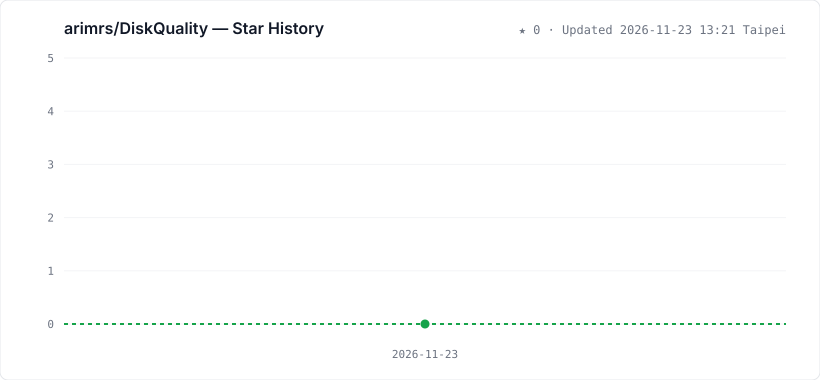

**English** | [简体中文](README.zh-CN.md)

# DiskQuality

[](CHANGELOG.md)
[](LICENSE)

An ultra-lightweight, bilingual (**English / 简体中文**), purely objective Linux benchmark suite built for **PT seedboxes, storage VPS, backup servers, VDS, and bare-metal dedicated servers**, paired with a minimalist paginated report server.

- **Adaptive 50% Capacity Algorithm & >65% Disk Guard**: Automatically scales the endurance stress file to **50% of total disk capacity** (clamped to ≤ 80% of free space and ≤ 2,000 GB on large arrays) within a **20-minute budget**. Runs a pre-test disk scan and **automatically cancels if disk usage exceeds 65%**.
- **Pre-Test Speed Probe & Time-Weighted Live ETA**: Performs a quick 64 MB write/read probe before launching to calculate realistic, time-weighted progress bars and a live remaining `ETA` countdown (recalibrated after FIO sequential write).
- **Dedicated / VDS / Non-KVM & Multi-Arch Compatible**: Automatically detects Bare-Metal Dedicated Servers, VDS, KVM/Xen/VMware/Hyper-V VPS, and LXC/OpenVZ/Docker containers across `x86_64` and `aarch64`, with automatic FIO `ioengine` / `O_DIRECT` fallback and `apt` / `dnf` / `yum` / `apk` / `pacman` / `zypper` support.
- **Quantifiable Scores & Pure Objective Data**: Computes an objective **Disk Composite Score (`0–100`, Grade `S+`–`D`)**, a Dedicated-baseline **Overselling Index (`0–100`, lower is better)**, and a **Multi-API Composite IP Risk Score (`0–100`, transparent per-API breakdown)** — zero subjective tuning fluff.
- **Streamlined 5-Step Interactive Flow & Thorough Cleanup**: Language selection at startup (`zh` / `en`), pre-flight dependency check (exits cleanly if declined), 4 merged `[Y/n]` groups + Geekbench `5/6/Skip` selector (skipped items render as bold red **`???`**), randomized start/end kaomoji, and automatic pre/post/`Ctrl+C` process-group & file cleanup (`fstrim`).
- **Minimalist Paginated Web Report & Persistent Storage**: 6-page NodeQuality-style matte dark report viewer (`←` / `→` keyboard switching, larger `17.5px` dynamic-width SVG, web-only cursor specular sheen), persistent storage by default (`DQ_TTL_SECONDS=0`, optional TTL supported), client-side Canvas PNG export, and one-click **Copy Text / NodeSeek (image tabs) / Markdown / PNG / SVG** buttons.

---

## Quick Start

Run directly on any Linux server (Debian / Ubuntu / RHEL / Rocky / AlmaLinux / Alpine / Arch / openSUSE):

```bash
bash <(curl -sL https://test.sakurado.top)
```

Optional CLI flags:
- `-l, --lang <zh|en>`: Pre-select Simplified Chinese or English
- `-d, --dir <path>`: Target mount directory (default: `/`)
- `-m, --minutes <N>`: Total time budget in minutes (default: `20`)
- `-p, --profile <auto|dedicated|vds|vps|container>`: Server architecture scheduling profile (default: `auto`)
- `--gb <gb5|gb6|skip>`: CPU benchmark mode (default: `gb5` Single/Multi-Core)
- `-y, --yes`: Non-interactive mode (accept defaults)
- `-h, --help`: Show usage help

---

## Benchmark Dimensions

1. **System & Block Device Topology**: Platform classification (`Dedicated` / `VDS` / `VPS` / `Container`), virtualization & architecture, OS/kernel, CPU/RAM/Swap, disk model, capacity, `ROTA`, I/O scheduler, `write_cache`, `read_ahead_kb`, sector size, TRIM/Discard, and auto-probed FIO engine.
2. **Quantifiable Evaluations & CPU Benchmark**:
   - **Disk Composite Score (`0–100`, Grade `S+`–`D`)**: Weighted objective score across sequential throughput, 4K random IOPS, latency/`fsync`, concurrency, sustained write, and metadata.
   - **Overselling Index (`0–100`, lower is better)**: Anchored to Dedicated Server NVMe / SATA SSD / Enterprise HDD baselines (`0` = dedicated baseline).
   - **Geekbench 5 / Geekbench 6 CPU**: Full Single-Core & Multi-Core scores with official result URL (`x86_64` & `aarch64`).
3. **Latency Baseline (`ioping`)**: Direct random seek, Page Cache read, and `fsync` sync write (`min / avg / max / mdev`, with safe fallback when `-D` is unsupported).
4. **FIO 14-Item Synthetic Matrix (Categorized: Sequential vs Random)**: Sequential 1MB R/W (`QD=1`, `QD=32×4`), Sequential 128K 50/50, Buffered 1M 50/50 (`direct=0`), Random 4KB R/W (`QD=1`, `QD=16`, `QD=64×4`), and Random 8K/16K 70/30 with throughput, IOPS, p95, and p99 latency.
5. **Production Workloads & `fsync` Commit**: OLTP 8K (`QD=32`), Web 16K (`QD=8`), WAL 4K (`fsync=1`, `QD=1`), Congested `fsync=4` (`QD=32`).
6. **Small-Block High-Concurrency I/O (PT / Backup)**:
   - `PT_SEED_16K_32T` (16KB random read, 32 threads, `QD=4`) — multi-peer PT seeding
   - `PT_HASH_256K_16T` (256KB sequential read, 16 threads, `QD=4`) — concurrent piece hashing
   - `BACKUP_64K_16T` (64KB 50/50 random R/W, 16 threads, `QD=4`) — parallel rsync / borg / restic streams
   - `BURST_4K_32T` (4KB 70/30 random R/W, 32 threads, `QD=1`) — high-concurrency small-file bursts
7. **50% Capacity Adaptive Endurance Stress + Per-Minute `iostat`**: Half budget continuous sequential write + half budget random mixed stress across a 50%-capacity file, sampled every 5 seconds with header-aware `sysstat 11.x/12.x` parsing (`r/s`, `w/s`, `rMB/s`, `wMB/s`, `w_await`, `%util`).
8. **Global Connectivity & Bulk Download Throughput**: Regional TCP handshake RTT & loss across 8 unicast hubs (APAC: Tokyo, Singapore, Hong Kong; US: Los Angeles, New York; EU: Frankfurt, London, Amsterdam) + Cloudflare 50MB & CacheFly 100MB download throughput.
9. **Multi-Source IP Quality, Composite Risk & Platform Reachability**:
   - **IP Identity & Native/Broadcast Check**: ASN, Org, Location, Datacenter/Residential & Native/Broadcast status, `ping0.cc` geo cross-check, SMTP Port 25 outbound check, and 3-zone DNSBL (`Spamhaus`, `Barracuda`, `SpamCop`).
   - **Composite Risk Score (`0–100`, lower is cleaner) + Full Per-API Breakdown**: Transparently aggregates **IPPure**, **IP2Location.io**, **ping0.cc**, **ProxyCheck.io**, **Scamalytics**, **ip-api.com**, and **DNSBL**, displaying every API's exact value.
   - **10-Platform Reachability & Denial Probability**: Cloudflare, Google, YouTube, Netflix, Disney+, TikTok, OpenAI, Reddit, GitHub, and Steam.
10. **Filesystem Metadata & Lifetime Diagnostics**: 10,000 × 4KB create/stat/read/unlink rates, `smartctl` SATA/NVMe power-on hours, and Ext4 superblock creation time / mount count / lifetime writes.

---

## Self-Hosting the Report Server

```bash
git clone https://github.com/arimrs/DiskQuality.git /opt/diskquality-server
cp /opt/diskquality-server/deploy/diskquality-web.service /etc/systemd/system/
# Edit DQ_SITE_URL, DQ_DATA_DIR, and optional DQ_TTL_SECONDS (0 = persistent) in the service file
systemctl daemon-reload && systemctl enable --now diskquality-web.service
```

Reverse proxy port `8765` with Nginx or Caddy. The server enforces strict privacy and security headers (`CSP`, `X-Robots-Tag: noindex, nofollow, noarchive`, `Referrer-Policy: no-referrer`, `X-Frame-Options: DENY`, `/robots.txt`, server-side IP masking & hostname stripping, and XSS-safe JSON serialization).

---

## Star History

<a href="https://github.com/arimrs/DiskQuality/stargazers">
  <picture>
    <source media="(prefers-color-scheme: dark)" srcset="assets/star-history-dark.svg" />
    <source media="(prefers-color-scheme: light)" srcset="assets/star-history-light.svg" />
    
  </picture>
</a>

---

## Acknowledgments & Upstream Tools

This project is built upon and inspired by the following outstanding open-source projects and public test services:

- **fio** — https://github.com/axboe/fio *(Direct I/O & high-concurrency storage engine)*
- **ioping** — https://github.com/koct9i/ioping *(low-level disk latency probing)*
- **Geekbench 5 / 6** — https://www.geekbench.com *(Single-Core & Multi-Core CPU benchmarking)*
- **sysstat / iostat** — https://github.com/sysstat/sysstat *(per-minute block device telemetry)*
- **smartmontools** — https://www.smartmontools.org *(SMART health & power-on telemetry)*
- **e2fsprogs / tune2fs** — https://e2fsprogs.sourceforge.net *(Ext4 superblock lifetime inspection)*
- **curl** — https://curl.se *(HTTP platform reachability & download probes)*
- **IPPure** — https://ippure.com *(fraud score, residential & native/broadcast detection)*
- **IP2Location.io** — https://www.ip2location.io *(proxy & geolocation lookup)*
- **ping0.cc** — https://ping0.cc *(geo & ASN cross-verification)*
- **ProxyCheck.io / Scamalytics** — https://proxycheck.io / https://scamalytics.com *(multi-source risk scoring)*
- **ip-api / ipinfo** — https://ip-api.com / https://ipinfo.io *(ASN & hosting classification metadata)*
- **Cloudflare Speed** — https://speed.cloudflare.com *(global CDN throughput test endpoint)*
- **CacheFly CDN** — https://www.cachefly.com *(bulk download throughput endpoint)*
- **NodeQuality** — https://github.com/LloydAsp/NodeQuality *(interactive workflow & matte web report UX inspiration)*
- **HardwareQuality** — https://github.com/xykt/HardwareQuality *(terminal ANSI & SVG highlight layout inspiration)*
- **IPQuality** — https://github.com/xykt/IPQuality *(IP quality & platform access check inspiration)*

---

## Open-Source Usage Terms & Disclaimer

### 1. Free to Use & Modify — No Paid Derivatives
- This project is **100% free and open-source**.
- **Secondary development and modification are welcome** for personal learning, research, and free community sharing, provided original attribution and this notice are retained.
- **Strictly NO paid/commercial derivatives**: You may **NOT** sell this project or any modified/derivative version of it, charge fees for customized builds, licensing, paid benchmark services, or repackage it into any closed-source or profit-driven product.

### 2. Strict Legal Compliance
- **No Illegal Use**: It is **strictly prohibited** to use this project (or any derivative work) to violate any applicable local, national, or international laws and regulations — including, without limitation, unauthorized stress testing, maliciously exhausting third-party disk/bandwidth/compute resources, DoS/DDoS attacks, or interfering with computer information systems.
- Users must ensure they only run this tool on servers they legally own or have explicit written authorization to test. All legal responsibilities and consequences arising from misuse are borne solely by the user; the author assumes zero liability.

### 3. General Disclaimers
1. **Disk Wear, Heavy I/O & Provider ToS**: This benchmark performs sustained Direct I/O writes up to 50% of total disk capacity (with a >65% pre-scan abort guard and ≤80% free-space clamp). You are solely responsible for evaluating SSD TBW wear, hardware impact, and your VPS provider's Terms of Service (ToS); any throttling, suspension, or data loss is at your own risk.
2. **Report Retention & AS-IS Warranty**: Uploaded reports store only anonymized JSON metrics (no raw IPs or hostnames) and are retained persistently by default (`DQ_TTL_SECONDS=0`; self-hosted instances may configure a custom TTL). This software is provided **"AS IS"** without warranty of any kind, express or implied (including merchantability, fitness for a particular purpose, or non-infringement). The author shall not be liable for any direct, indirect, incidental, special, or consequential damages.
3. **Objective Metrics & Third-Party Services**: All outputs are raw objective measurements and do not constitute purchasing advice or performance guarantees. Upstream open-source tools and public test APIs belong to their respective owners, who are solely responsible for their availability and accuracy.
4. **Privacy**: Public IPv4/IPv6 addresses in reports are automatically masked (`x.x.*.*` / `xxxx:xxxx:*:*`), hostnames are never stored, and report pages carry `noindex, nofollow, noarchive` and `Referrer-Policy: no-referrer`. Do not manually attach sensitive personal or system information.
