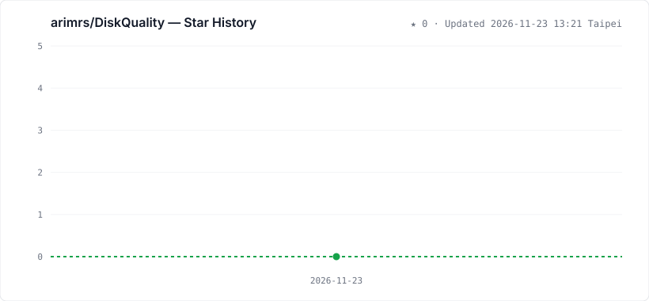

[English](README.md) | **简体中文**

# DiskQuality

[](CHANGELOG.md)
[](LICENSE)

超轻量、中英双语（**简体中文 / English**）、纯客观数据的 Linux 深度测评套件，适用于 **PT 刷流机、大盘存储机、备份服务器、VDS 与裸金属独立服务器**，并配套极简可翻页在线报告服务端。

- **自适应 50% 容量算法 + 65% 空间安全熔断**：自动按目标硬盘总容量的 **50%** 动态调节持久压测文件体积（安全钳制 ≤ 可用空间的 80%，超大阵列上限 2000 GB），全流程收敛至 **20 分钟**。启动前自动扫描硬盘占用，**若占用高于 65% 则自动提示“硬盘空间不足，已自动取消运行”**。
- **预热测速校准 + 时间加权实时 ETA**：测试前先执行 64 MB 快速读写预热，结合目标盘容量与实测速率计算按时间加权的进度条与实时剩余 `ETA` 倒计时（并在 FIO 顺序写完成后二次校准）。
- **独立服务器 / VDS / 非 KVM 与多架构全兼容**：自动识别裸金属独服、VDS、KVM/Xen/VMware/Hyper-V 与 LXC/OpenVZ/Docker 容器，兼容 `x86_64` / `aarch64`，支持 FIO 引擎与 `O_DIRECT` 自动降级及 `apt` / `dnf` / `yum` / `apk` / `pacman` / `zypper` 多发行版包管理器。
- **客观量化评分与纯数据呈现**：内置 **硬盘综合评分（`0–100` / `S+`–`D`）**、独立服务器基准 **超售指数（`0–100`，越低越好）** 与 **多源 IP 综合风控值（`0–100`，完整透明展示各 API 原始构成）**，去除一切主观调优废话。
- **5 步精简交互与彻底环境清理**：启动即选语言（中/英）；运行前自动检查依赖，不同意安装即安全退出；4 组精简 `[Y/n]` 选测 + Geekbench `5/6/跳过` 选择（跳过项统一标红 **`？？？`**）；仅在开始/结束随机展示颜文字；测试前后及 `Ctrl+C` 中断时按进程组秒杀残留任务并彻底清理临时目录（含 `fstrim`）。
- **极简炭黑可翻页网页与永久保存**：6 页 NodeQuality 风格炭黑磨砂翻页结果页（支持键盘 `←` / `→` 切换、`17.5px` 大字号自适应宽度 SVG、网页端专属鼠标柔和光影动效），默认长期保存报告（`DQ_TTL_SECONDS=0`，自建亦可选配 TTL），浏览器本地 Canvas 导出 PNG，内置 **复制文本 / 复制为NodeSeek格式（图片多标签）/ 复制为通用Markdown / 导出PNG / SVG** 按钮。

---

## 快速开始

在任意 Linux 服务器（Debian / Ubuntu / RHEL / Rocky / AlmaLinux / Alpine / Arch / openSUSE）上直接运行：

```bash
bash <(curl -sL https://test.sakurado.top)
```

可选参数：
- `-l, --lang <zh|en>`：预设简体中文或英文
- `-d, --dir <path>`：指定测评挂载路径（默认 `/`）
- `-m, --minutes <N>`：总测评时长预算（单位：分钟，默认 `20`）
- `-p, --profile <auto|dedicated|vds|vps|container>`：服务器架构调度模式（默认 `auto`，自动兼容独立服务器、VDS、KVM/Xen/VMware、LXC/OpenVZ/Docker 与多架构）
- `--gb <gb5|gb6|skip>`：指定 CPU 跑分版本（默认 `gb5` 完整单核/多核）
- `-y, --yes`：非交互自动模式（全部模块默认选 `y` / `gb5`）
- `-h, --help`：查看命令帮助

---

## 测评维度

1. **系统与块设备拓扑**：自动识别平台类型（`DEDICATED` / `VDS` / `VPS` / `CONTAINER`）、虚拟化与架构、OS/内核、CPU/内存/Swap、磁盘型号、容量、`ROTA`、I/O 调度器、`write_cache`、`read_ahead_kb`、扇区规格、TRIM/Discard 支持与 FIO 自动探测引擎。
2. **综合量化评估与 CPU 跑分**：
   - **硬盘综合评分（`0–100` / `S+`–`D`）**：综合顺序吞吐、4K 随机、延迟/`fsync`、高并发、持久稳态与元数据加权评分。
   - **超售指数（`0–100`，越低越好）**：锚定标准独立服务器 NVMe / SATA SSD / 企业级 HDD 基准（`0` = 独服水平）。
   - **Geekbench 5 / Geekbench 6 CPU 跑分**：完整单核与多核分数及官方详情链接（支持 `x86_64` 与 `aarch64`）。
3. **底层延迟基线（`ioping`）**：Direct I/O 原生随机寻道、Page Cache 缓存读、`fsync` 持久化同步写（`min / avg / max / mdev`，不支持 `-D` 时自动安全降级）。
4. **FIO 14 项合成性能矩阵（分块归类：顺序大块 vs 随机小块）**：顺序 1MB 读/写（`QD=1`, `QD=32×4`）、顺序 128K 50/50、Buffered 1M 50/50（`direct=0`）、随机 4KB 读/写（`QD=1`, `QD=16`, `QD=64×4`）、随机 8K/16K 70/30，输出吞吐、IOPS、p95 与 p99。
5. **生产场景模型与 `fsync` 事务刷盘**：OLTP 8K（`QD=32`）、Web 16K（`QD=8`）、WAL 4K（`fsync=1`, `QD=1`）、高并发拥塞 `fsync=4`（`QD=32`）。
6. **小量多并发 I/O（PT / 备份机核心）**：
   - `PT_SEED_16K_32T`（16KB 随机读，32 并发线程，`QD=4`）— 多 Peer PT 做种读取模型
   - `PT_HASH_256K_16T`（256KB 顺序读，16 并发线程，`QD=4`）— 多任务种子分片 Hash 校验
   - `BACKUP_64K_16T`（64KB 50/50 随机读写，16 并发线程，`QD=4`）— rsync / borg / restic 多流备份
   - `BURST_4K_32T`（4KB 70/30 随机读写，32 并发线程，`QD=1`）— 高并发小文件突发压力
7. **50% 容量自适应持久压测 + 逐分钟 `iostat` 时序**：前半段连续大文件顺序写 + 后半段随机混合重载，每 5 秒采样并按表头动态兼容 `sysstat 11.x / 12.x` 汇总逐分钟 `r/s`、`w/s`、`rMB/s`、`wMB/s`、`w_await`、`%util`。
8. **国际互联能力与大文件下行吞吐（按亚太/美洲/欧洲分区）**：全球 8 大单播枢纽（亚太：东京、新加坡、香港；美洲：洛杉矶、纽约；欧洲：法兰克福、伦敦、阿姆斯特丹）TCP 握手延迟与丢包率 + Cloudflare 50MB / CacheFly 100MB 实测速度。
9. **多源 IP 质量、综合风控值与平台可达性**：
   - **IP 基础画像**：ASN/组织/归属地、机房/住宅与原生/广播判定、`ping0.cc` 归属交叉校验、出站 SMTP 25 端口检测、3 库 DNSBL 黑名单（`Spamhaus` / `Barracuda` / `SpamCop`）。
   - **综合风控值（`0–100`，越低越干净）与各 API 构成明细**：综合对接 **IPPure**、**IP2Location.io**、**ping0.cc**、**ProxyCheck.io**、**Scamalytics**、**ip-api.com** 与 **DNSBL**，并将每个接口的原始分值清晰列出。
   - **10 大主流平台可达性与被拒概率**：Cloudflare、Google、YouTube、Netflix、Disney+、TikTok、OpenAI、Reddit、GitHub、Steam。
10. **文件系统元数据与介质通电寿命溯源**：10,000 × 4KB 小文件创建/Stat/读/删速率、`smartctl` SATA/NVMe 通电小时读取及 Ext4 超级块创建时间/挂载次数/累计写入量。

---

## 自建在线报告服务端

```bash
git clone https://github.com/arimrs/DiskQuality.git /opt/diskquality-server
cp /opt/diskquality-server/deploy/diskquality-web.service /etc/systemd/system/
# 修改 /etc/systemd/system/diskquality-web.service 中的 DQ_SITE_URL、DQ_DATA_DIR 及可选 DQ_TTL_SECONDS（0=永久保存）
systemctl daemon-reload && systemctl enable --now diskquality-web.service
```

使用 Nginx / Caddy 反向代理本地 `8765` 端口即可。服务端内置防存储型 XSS 转义、服务端强制 IP 二次打码与主机名剥离、`CSP` / `X-Robots-Tag: noindex, nofollow, noarchive` / `Referrer-Policy: no-referrer` / `X-Frame-Options: DENY` 安全隐私头及 `/robots.txt` 防收录策略。

---

## Star 增长曲线

<a href="https://github.com/arimrs/DiskQuality/stargazers">
  <picture>
    <source media="(prefers-color-scheme: dark)" srcset="assets/star-history-dark.svg" />
    <source media="(prefers-color-scheme: light)" srcset="assets/star-history-light.svg" />
    
  </picture>
</a>

---

## 致谢与底层检测工具原站

本项目基于以下优秀开源项目与公共检测服务构建，并致敬其设计理念：

- **fio** — https://github.com/axboe/fio *（Direct I/O 与高并发存储压测引擎）*
- **ioping** — https://github.com/koct9i/ioping *（底层磁盘延迟基准探测）*
- **Geekbench 5 / 6** — https://www.geekbench.com *（CPU 单核与多核基准跑分）*
- **sysstat / iostat** — https://github.com/sysstat/sysstat *（逐分钟块设备时序采样）*
- **smartmontools** — https://www.smartmontools.org *（SMART 健康与通电寿命读取）*
- **e2fsprogs / tune2fs** — https://e2fsprogs.sourceforge.net *（Ext4 超级块寿命与写入量溯源）*
- **curl** — https://curl.se *（HTTP 平台可达性与大文件下载探测）*
- **IPPure** — https://ippure.com *（欺诈风控分、住宅与原生/广播判定）*
- **IP2Location.io** — https://www.ip2location.io *（代理与归属地检测）*
- **ping0.cc** — https://ping0.cc *（中文归属地与 ASN 交叉校验）*
- **ProxyCheck.io / Scamalytics** — https://proxycheck.io / https://scamalytics.com *（多源风险评分接口）*
- **ip-api / ipinfo** — https://ip-api.com / https://ipinfo.io *（ASN 与机房属性元数据查询）*
- **Cloudflare Speed** — https://speed.cloudflare.com *（全球 CDN 下载吞吐测速节点）*
- **CacheFly CDN** — https://www.cachefly.com *（国际大文件下载吞吐节点）*
- **NodeQuality** — https://github.com/LloydAsp/NodeQuality *（致敬交互流程与哑光网页报告体验）*
- **HardwareQuality** — https://github.com/xykt/HardwareQuality *（致敬终端 ANSI 与高亮条排版风格）*
- **IPQuality** — https://github.com/xykt/IPQuality *（致敬 IP 质量与平台可达性检测理念）*

---

## 开源声明、使用规范与免责声明

### 一、完全免费与二次开发（二改）声明
- 本项目**完全免费**开源，欢迎个人学习、测试与社区免费分享。
- **允许二次修改（二改）**：允许在保留原作者署名与本声明的前提下，对本项目进行二次开发、定制与免费分发。
- **严禁收费二改与商业倒卖**：**严禁将本项目或基于本项目的任何二次修改版本用于收费售卖、付费二改、付费授权、付费代测、闭源倒卖或任何形式的商业盈利行为**。

### 二、严禁违法违规使用声明
- **严禁借此项目违反法律法规**：严禁利用本项目或其任何二次修改版本从事任何违反所在地及相关国家/地区法律法规的行为，包括但不限于未经授权的压力测试、恶意耗尽他人服务器磁盘/带宽/计算资源、发起 DoS/DDoS 攻击、破坏计算机信息系统等。
- 使用者必须确保仅在拥有合法所有权或明确书面授权的设备上运行本工具；任何因违规或非法使用所引发的一切法律责任与后果均由使用者本人自行承担，与本项目作者无关。

### 三、常见免责声明
1. **磁盘写入损耗与服务商 ToS 风险**：本工具会在目标挂载点产生最高达硬盘总容量 50%（内置 >65% 空间熔断及 ≤ 可用空间 80% 钳制）的持续 Direct I/O 写入。请自行评估 SSD TBW 写入寿命、硬件损耗及云服务商 ToS 条款，因压测导致的限速、停机、封号或数据损失风险均由使用者自行承担。
2. **数据留存与按“现状（AS-IS）”提供**：服务端仅保存脱敏后的 JSON 客观测评指标（不存原始 IP 与主机名），默认持久化保存（`DQ_TTL_SECONDS=0`，自建部署可按需配置定时销毁 TTL）。本软件按“现状（AS IS）”提供，不附带任何明示或暗示的担保（包括但不限于适销性、特定用途适用性及不侵权担保），作者不对任何直接、间接、偶然、特殊或衍生损失承担任何赔偿责任。
3. **客观数据与第三方工具声明**：本工具仅输出原始客观数据，不构成任何主机选购建议或性能承诺；所调用的第三方开源检测工具与公共接口均归各自原站所有，其可用性、稳定性与结果准确性由对应上游提供方负责。
4. **隐私保护**：测评报告中的公网 IPv4 / IPv6 默认自动打码（`x.x.*.*` / `xxxx:xxxx:*:*`）、不上报主机名，且报告页默认配置 `noindex, nofollow, noarchive` 与 `Referrer-Policy: no-referrer`，请勿在报告中主动附加任何敏感个人或业务信息。
